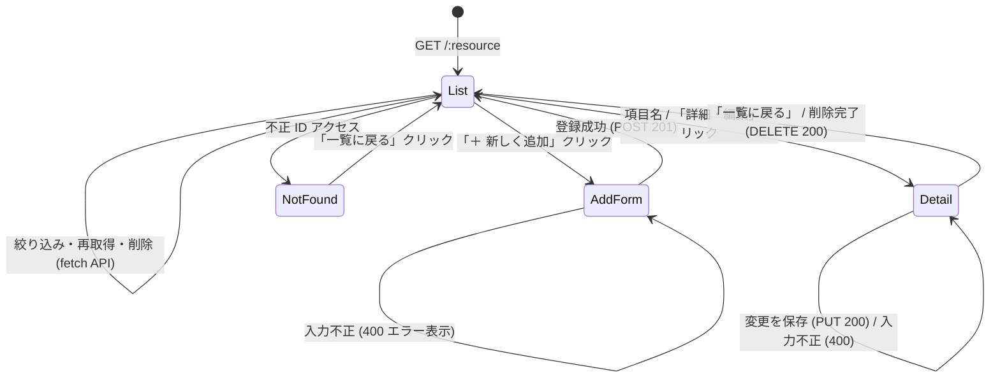
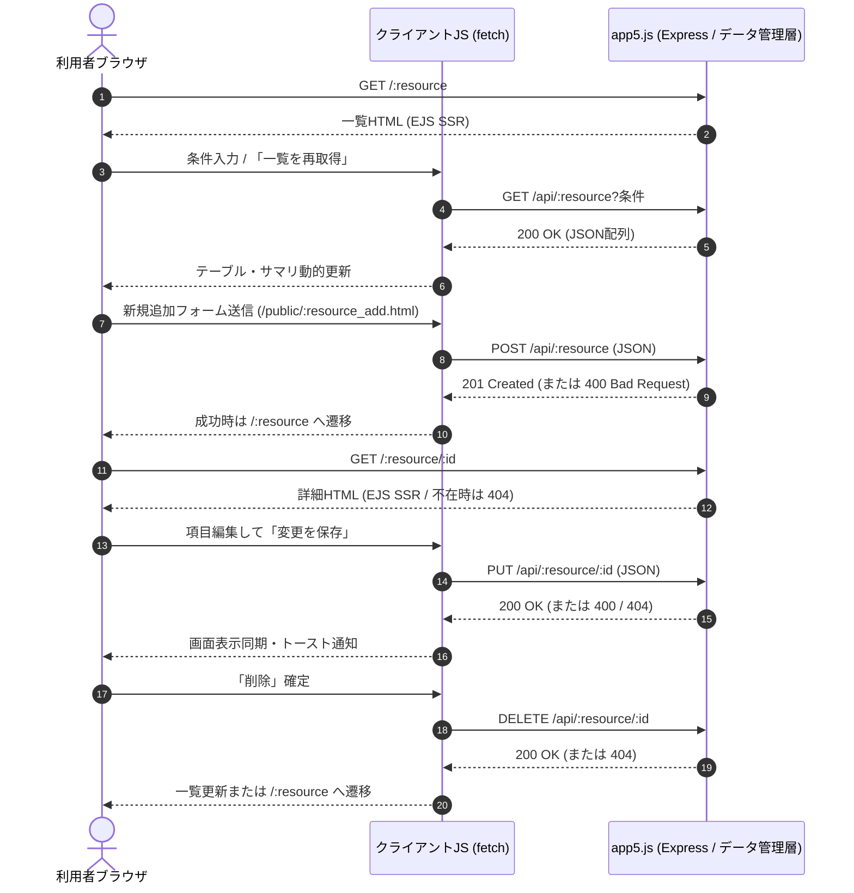

# Webアプリケーション開発 仕様書

- **ソースコードリポジトリ**: https://github.com/iotaish/webpro
- **対象サーバファイル**: `app5.js`
- **技術スタック**: Node.js / Express / EJS / Vanilla JavaScript (`fetch`)

## 対象アプリケーション一覧

| No. | アプリケーション名 | 画面URL | REST API ベースURL | 概要 |
| --- | --- | --- | --- | --- |
| 1 | 授業・時間割管理 | `/classes` | `/api/classes` | 未定（今後追記） |
| 2 | 未定 | 未定 | 未定 | 未定 |
| 3 | 未定 | 未定 | 未定 | 未定 |

---

# 第1部 利用者向け仕様

## 1.1. 利用前の準備

ブラウザ（Chrome / Safari / Edge / Firefox 等のモダンブラウザ、JavaScript 有効）からサーバの URL（ローカル環境では `http://localhost:8080`）へアクセスする。

## 1.2. 画面URL一覧

各アプリケーション共通で、以下の URL 設計パターンで操作できる。

| 種別 | URL パターン | 備考 |
| --- | --- | --- |
| 一覧画面 | `GET /:resource` | 初期表示は EJS による一覧描画 |
| 新規追加画面 | `/public/:resource_add.html` | 登録成功後、一覧画面へ遷移 |
| 詳細・直接編集・削除画面 | `GET /:resource/:id` | 存在しない ID 指定時は HTTP `404` 表示 |

- 各アプリの実ルート例:
  - アプリ1（授業・時間割管理）: `/classes`, `/public/classes_add.html`, `/classes/:id`
  - アプリ2: 未定
  - アプリ3: 未定

## 1.3. 基本操作手順（全アプリ共通）

### 1.3.1. 一覧表示・サマリ確認・絞り込み
1. 各アプリの一覧画面 URL（`/:resource`）を開く。
2. 画面上部のサマリバーに表示件数や集計値が表示され、その下に登録データが表形式で一覧表示される。
3. 絞り込みバーの条件選択やキーワード検索欄に入力すると、条件に一致するデータのみが即座に再取得されて表とサマリが更新される。「条件クリア」ボタンで絞り込みを解除できる。
4. 「一覧を再取得」ボタンを押すと、サーバから最新データを再取得して表を更新し、画面上部中央に緑色の完了通知（トースト）がポップ表示され、約1.8秒後に自動で消える。

### 1.3.2. 詳細表示
1. 一覧画面のテーブルにある項目名リンク、または「詳細・編集」ボタンをクリックする。
2. 選択したデータの全項目が詳細画面のテーブルに表示される。
3. 一覧へ戻りたい場合は「一覧に戻る」リンクをクリックする。

### 1.3.3. 新規追加
1. 一覧画面上部の「＋ 新しい〇〇を追加する」ボタンをクリックして登録画面へ移動する。
2. フォームに各項目を入力・選択し、「登録」ボタンをクリックする。
3. 入力内容が正しい場合はデータが追加され、一覧画面へ自動的に戻る。
4. 必須項目が未入力、選択肢以外、または数値範囲外の場合は、画面上部に赤色のエラーメッセージが表示される。

### 1.3.4. データの変更（更新）
1. 一覧画面から対象アイテムの「詳細・編集」をクリックし、詳細画面を開く。
2. 詳細テーブルの各項目欄（ID を除く）がそのまま入力・選択欄になっているため、変更したい値を直接書き換える。
3. 「変更を保存」ボタンをクリックすると内容が保存され、ページタイトル・見出し・表示値が同期するとともに、画面上部中央に緑色の完了通知（トースト）がポップ表示され、約1.8秒後に自動で消える。
4. 入力内容が不正な場合は赤色のエラーメッセージが画面上に残る。

### 1.3.5. データの削除
- **一覧画面から削除する場合**: 対象行の「削除」ボタンをクリックし、確認ダイアログで「OK」を選択する。削除後は表・サマリが更新され、画面上部中央に緑色の完了通知（トースト）がポップ表示され約1.8秒後に自動で消える。
- **詳細画面から削除する場合**: 画面下部の「削除」ボタンをクリックし、確認ダイアログで「OK」を選択すると削除され、一覧画面へ戻る。

## 1.4. 各アプリの入力項目と制限

### 1.4.1. 授業・時間割管理（`/classes`）

（今後策定）

### 1.4.2. 第2アプリケーション（未定）

（今後策定）

### 1.4.3. 第3アプリケーション（未定）

（今後策定）

---

# 第2部 管理者向け仕様

## 2.1. 動作環境と依存関係

| 項目 | 仕様 |
| --- | --- |
| 実行ランタイム | Node.js |
| モジュール方式 | CommonJS（`package.json` の `"type": "commonjs"`） |
| 依存パッケージ | `express` (`^4.21.2`), `ejs` (`^3.1.10`) |
| 待ち受けポート | `8080`（`http://localhost:8080`、環境変数 `PORT` で上書き可） |

## 2.2. 起動・停止手順

1. 初回または依存更新時はリポジトリルートで依存パッケージをインストールする。
   ```sh
   npm install
   ```
2. 以下のコマンドでサーバを起動する。
   ```sh
   npm start
   ```
   （内部で `node app5.js` を実行）
3. コンソールに待ち受け開始メッセージが表示されたら起動完了となる。
4. 停止する場合は起動中のターミナルで `Ctrl + C` を押下する。

## 2.3. データ管理と永続化に関する仕様

（今後策定）

## 2.4. 運用監視とトラブルシューティング

- **ポート競合エラー（`EADDRINUSE`）**:
  - すでに別のプロセスがポート `8080` を使用している場合、起動に失敗する。
  - `lsof -i :8080` で占有プロセスを確認して停止するか、環境変数 `PORT` で別ポートを指定する。
- **不正な入力による `400 Bad Request`**:
  - 必須項目の欠落や許容範囲外の値が送信された場合、API は HTTP ステータス `400` と JSON 形式のエラーメッセージ `{ "error": "..." }` を返す。
- **存在しない ID へのアクセス（`404 Not Found`）**:
  - 削除済みまたは未登録の ID、あるいは正の整数でない ID が指定された場合、HTML 画面ルートではステータス `404` のテンプレートを返し、REST API ではステータス `404` と `{ "error": "..." }` を返す。

---

# 第3部 開発者向け仕様

## 3.1. リポジトリおよびファイル構成

- **リポジトリ URL**: https://github.com/iotaish/webpro

```text
.
├── app5.js                         # メインサーバ（HTML ルーティング・REST API）
├── package.json                    # 依存パッケージおよび起動スクリプト（npm start）
├── spec.md                         # 本仕様書
├── public/                         # 静的ファイル（新規追加フォーム HTML・クライアント JS）
│   ├── <resource>_add.html         # 各アプリの新規追加フォーム
│   ├── <resource>_add.js           # 新規追加フォーム送信スクリプト（POST /api/<resource>）
│   ├── <resource>.js               # 一覧画面制御スクリプト（絞り込み・再取得・削除）
│   └── <resource>_detail.js        # 詳細・直接編集スクリプト（PUT / DELETE）
└── views/                          # EJS テンプレート（SSR 初期表示・404 応答）
    ├── <resource>.ejs              # 一覧画面テンプレート
    └── <resource>_detail.ejs       # 詳細・直接編集画面テンプレート
```

（各アプリで追加したファイル一覧は対象アプリの仕様策定時に追記）

## 3.2. コーディング規約・設計方針

1. **`"use strict";` の徹底**:
   - 今回作成・更新するすべてのサーバ側・クライアント側 JS ファイルの先頭に `"use strict";` を記述し、厳格モードで実行する。
2. **HTML ルートと REST API ルートの責務分離**:
   - 初期画面描画（`GET /:resource`, `GET /:resource/:id`）は EJS による SSR とし、検索・追加・更新・削除の各操作は `/api/:resource` 配下の JSON REST API とクライアント側 `fetch` で処理する。
3. **サーバ側バリデーションと統一 HTTP ステータス**:
   - 入力値の検証をサーバ側で一元化し、必須項目欠落・型不正・範囲外は `400 Bad Request`（`{ "error": "..." }`）、対象 ID 不在は HTML/API ともに `404 Not Found` を返す。
4. **XSS（クロスサイトスクリプティング）対策**:
   - クライアント JS で API レスポンスを描画する際は `innerHTML` への文字列連結を行わず、`document.createElement` と `textContent` を組み合わせて安全に DOM を構築する。

## 3.3. 画面遷移図と通信シーケンス

### 3.3.1. 共通画面遷移図



### 3.3.2. 共通通信シーケンス（一覧・詳細・CRUD）



## 3.4. データモデルと REST API 仕様

### 3.4.1. 授業・時間割管理（`/classes`, `/api/classes`）

（今後策定）

### 3.4.2. 第2アプリケーション（未定）

（今後策定）

### 3.4.3. 第3アプリケーション（未定）

（今後策定）

## 3.5. 授業で説明していない技術の概要と採用理由

| 技術名 | 概要 | 採用の理由 |
| --- | --- | --- |
| HTTP メソッド（`POST` / `PUT` / `DELETE`） | 資源の作成（`POST`）・全体または項目更新（`PUT`）・削除（`DELETE`）を意味づける HTTP メソッド | 授業前半では `GET` 中心（一部 `POST` のみ）だったが、REST API の設計原則に沿って操作種別を URL とメソッドで明確に分離するため採用。 |
| `express.urlencoded()` / `express.json()` | リクエストボディを解析して `req.body` に格納する Express 標準ミドルウェア | フォーム送信（URL エンコード形式）と REST API 通信（JSON 形式）の双方をサーバ側で安全かつ簡潔に受け取るため採用。 |
| ブラウザ `fetch` API | ブラウザから非同期で HTTP リクエストを送受信する Web 標準 API | 画面全体をリロードせずに一覧の再取得・絞り込み・直接編集・削除を即座に反映し、操作性の高い UI を実現するため採用。 |
