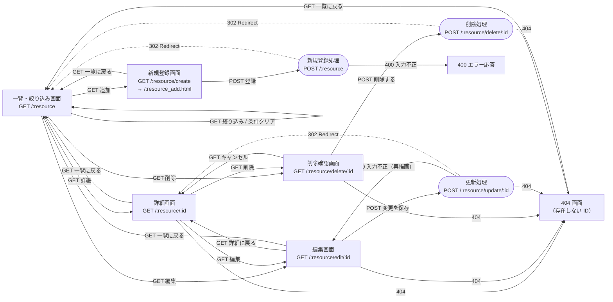
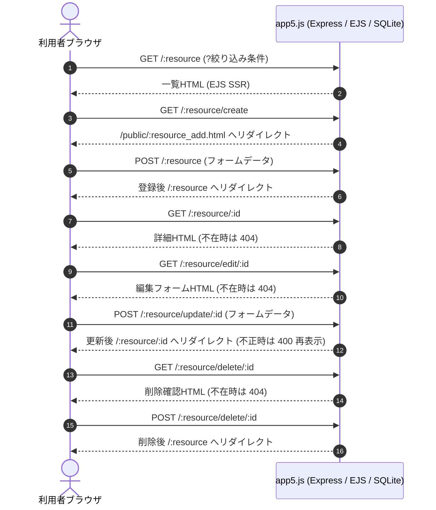

# Webアプリケーション開発 仕様書

- **ソースコードリポジトリ**: https://github.com/iotaish/webpro
- **対象サーバファイル**: `app5.js`
- **技術スタック**: Node.js / Express / EJS / HTML Form / SQLite (`node:sqlite`)

## 対象アプリケーション一覧

| No. | アプリケーション名 | 画面・API ベースURL | 概要 |
| --- | --- | --- | --- |
| 1 | 授業・時間割管理 | `/classes` | 履修授業（科目名・曜日・時限・教室・担当教員・単位数・メモ）の一覧・検索・CRUD 管理 |
| 2 | 積みゲー・積読リスト | `/backlog` | 積んでいるゲーム・書籍（種別・媒体・積み年数・想定所要時間・ステータス・メモ）の一覧・絞り込み・CRUD 管理 |
| 3 | 第3アプリケーション（未定） | 未定 | 今後策定予定 |

---

## 第1部 利用者向け仕様

本仕様書では、3つのアプリケーションのうち操作体系が共通している代表的なシステムとして「授業・時間割管理（`/classes`）」を例に利用手順を示す。

### 1.1. 利用前の準備

ブラウザ（Chrome / Safari / Edge / Firefox 等のモダンブラウザ）からサーバの URL（ローカル環境では `http://localhost:8080`）へアクセスする。

### 1.2. 画面URL一覧

| 種別 | URL | 備考 |
| --- | --- | --- |
| 一覧・絞り込み画面 | `GET /classes` | クエリ `?day=...&q=...` で絞り込み可能 |
| 新規追加画面 | `GET /classes/create` | `/public/classes_add.html` へリダイレクト |
| 詳細画面 | `GET /classes/:id` | 存在しない ID 指定時は HTTP `404` 表示 |
| 編集画面 | `GET /classes/edit/:id` | 既存値を初期入力したフォームを表示 |
| 削除確認画面 | `GET /classes/delete/:id` | 削除対象を確認後に削除を実行 |

### 1.3. 基本操作手順

#### 1.3.1. 一覧表示・サマリ確認・絞り込み

1. 一覧画面 URL（`/classes`）を開く。
2. 画面上部のサマリバーに表示中の件数および合計単位数が表示され、その下に登録データが表形式で一覧表示される。
3. 曜日セレクト（`すべて` / `月`〜`土`）やキーワード検索欄（科目名・教室・担当教員・メモの部分一致）を入力して「絞り込み」ボタンを押すと、条件に一致するデータのみが表示される。「条件クリア」リンクで絞り込みを解除できる。

#### 1.3.2. 詳細表示

1. 一覧画面のテーブルにある科目名リンク、または「詳細」ボタンをクリックする。
2. 選択した授業の全項目が詳細画面のテーブルに表示される。
3. 一覧へ戻りたい場合は「授業一覧に戻る」リンクをクリックする。

#### 1.3.3. 新規追加

1. 一覧画面上部の「＋ 新しい授業を追加する」ボタンをクリックして登録画面へ移動する。
2. フォームに各項目を入力・選択し、「登録」ボタンをクリックする。
3. 入力内容が正しい場合はデータが追加され、一覧画面へ自動的に戻る。
4. 必須項目が未入力、選択肢以外、または数値範囲外の場合は HTTP `400` のエラーメッセージが表示される。

#### 1.3.4. データの変更（更新）

1. 一覧画面または詳細画面の「編集」ボタンをクリックし、編集画面を開く。
2. 変更したい項目を書き換えて「変更を保存」ボタンをクリックすると内容が保存され、詳細画面へ戻る。
3. 入力内容が不正な場合は編集画面上に赤色のエラーメッセージが表示される。

#### 1.3.5. データの削除

1. 一覧画面または詳細画面の「削除」ボタンをクリックし、削除確認画面を開く。
2. 削除対象の内容を確認し、「削除する」ボタンをクリックすると削除が実行され、一覧画面へ戻る（取りやめる場合は「キャンセル」をクリックする）。

### 1.4. 入力項目と制限（授業・時間割管理）

| 項目名 | フィールド名 | 必須 | 型 / 入力形式 | 制限・初期値 |
| --- | --- | --- | --- | --- |
| 科目名 | `course` | 必須 | テキスト | 前後空白除去後に空文字不可 |
| 曜日 | `day` | 必須 | セレクト | `月` / `火` / `水` / `木` / `金` / `土` のみ許可（新規フォーム初期値: `金`） |
| 時限 | `period` | 必須 | テキスト | 前後空白除去後に空文字不可（例: `2-3限`） |
| 教室 | `room` | 必須 | テキスト | 前後空白除去後に空文字不可（例: `1102`） |
| 担当教員 | `teacher` | 任意 | テキスト | 未入力時は空文字 |
| 単位数 | `credits` | 任意（実質整数） | 数値 | `1`〜`10` の整数（未指定・空文字時は初期値 `2`） |
| メモ | `memo` | 任意 | テキストエリア | 講義概要・自由記述 |

---

## 第2部 管理者向け仕様

### 2.1. 動作環境と依存関係

| 項目 | 仕様 |
| --- | --- |
| 実行ランタイム | Node.js（標準組み込み `node:sqlite` を利用） |
| モジュール方式 | CommonJS（`package.json` の `"type": "commonjs"`） |
| 依存パッケージ | `express` (`^4.21.2`), `ejs` (`^3.1.10`) |
| 待ち受けポート | `8080`（`http://localhost:8080`、環境変数 `PORT` で上書き可） |

### 2.2. 起動・停止手順

1. 初回または依存更新時はリポジトリルートで依存パッケージをインストールする。

   ```sh
   npm install
   ```

2. 以下のコマンドでサーバを起動する（内部で `node app5.js` を実行）。

   ```sh
   npm start
   ```

3. コンソールに `Example app listening on port 8080!` が表示されたら起動完了となる。
4. 停止する場合は起動中のターミナルで `Ctrl + C` を押下する。

### 2.3. データ管理と永続化に関する仕様

- **変更の経緯**: 初期実装ではメモリ内配列で管理していたが、サーバ再起動時に登録・編集・削除内容が失われるため、ファイルベースの永続化（SQLite）へ仕様変更した。
- **授業・時間割管理（`/classes`）**:
   - `node:sqlite`（`DatabaseSync`）を用いて `timetable.db`（環境変数 `TIMETABLE_DB_PATH` でパス変更可）の `classes` テーブルに永続化する。
   - 旧スキーマ（`teacher` / `credits` / `memo` 列なし）の既存 DB を読み込んだ場合は、`ALTER TABLE ... ADD COLUMN` により安全に列を拡張する。
- **積みゲー・積読リスト（`/backlog`）**:
   - アプリ 1 での永続化方針を踏まえ、当初から `node:sqlite`（`DatabaseSync`）を用いて `backlog.db`（環境変数 `BACKLOG_DB_PATH` でパス変更可）の `backlog` テーブルに永続化する。
- **既存 DB 非初期化ルール（共通）**:
   - 起動時に `.db` ファイルが**存在しない場合のみ**、テーブルの作成と初期 5 件の投入を行う。
   - すでに `.db` ファイルが存在する場合は、レコード件数が 0 件（全件削除済み）であっても再初期化や初期データの再投入を行わず、既存データをそのまま読み込む。
- **第3アプリケーション**: 今後策定・追記する。

### 2.4. 運用監視とトラブルシューティング

- **ポート競合エラー（`EADDRINUSE`）**:
   - すでに別のプロセスがポート `8080` を使用している場合、起動に失敗する。
   - `lsof -i :8080` で占有プロセスを確認して停止するか、環境変数 `PORT` で別ポートを指定する。
- **不正な入力による `400 Bad Request`**:
   - 必須項目の欠落や許容範囲外の値が送信された場合、HTTP ステータス `400` とエラーメッセージを返す。
- **存在しない ID へのアクセス（`404 Not Found`）**:
   - 削除済みまたは未登録の ID、あるいは正の整数でない ID が指定された場合、HTML 画面ルートではステータス `404` のテンプレートを返す。

---

## 第3部 開発者向け仕様

### 3.1. リポジトリ全体構成と共通設計方針

- **リポジトリ URL**: https://github.com/iotaish/webpro

```text
.
├── app5.js                         # メインサーバ（EJS SSR ルーティング・フォーム処理）
├── package.json                    # 依存パッケージおよび起動スクリプト（npm start）
├── spec.md                         # 本仕様書
├── public/                         # 静的ファイル（新規追加フォーム HTML・CSS）
│   ├── app.css                     # 全アプリ共通スタイルシート
│   └── <resource>_add.html         # 各アプリの新規追加フォーム
└── views/                          # EJS テンプレート（SSR 描画・404 応答）
    ├── <resource>.ejs              # 一覧画面テンプレート
    ├── <resource>_detail.ejs       # 詳細画面テンプレート
    ├── <resource>_edit.ejs         # 編集画面テンプレート
    └── <resource>_delete.ejs       # 削除確認画面テンプレート
```

1. **`"use strict";` の徹底**:
   - サーバ側 JS（`app5.js`）の先頭に `"use strict";` を記述し、厳格モードで実行する。
2. **授業例（`keiyo2`）と統一した操作設計**:
   - 一覧（`GET /:resource`）、新規追加フォーム（`GET /:resource/create` → `/public/:resource_add.html`）、新規登録処理（`POST /:resource`）、詳細（`GET /:resource/:id`）、編集フォーム（`GET /:resource/edit/:id`）、更新処理（`POST /:resource/update/:id`）、削除確認・実行（`GET /:resource/delete/:id`・`POST /:resource/delete/:id`）のリソース名とページ遷移を全アプリで統一している。
   - Express のルート照合順序に依存するため、`GET /:resource/create`、`GET /:resource/edit/:id`、`GET /:resource/delete/:id` を `GET /:resource/:id` より前に定義している。
   - `keiyo2` では `GET /keiyo2/delete/:number` で即時削除していたのに対し、自作アプリでは誤削除防止のため削除確認ページ（`GET /:resource/delete/:id`）を経由して `POST /:resource/delete/:id` で削除する構成としている。
3. **サーバ側バリデーションと統一 HTTP ステータス**:
   - 入力値の検証をサーバ側で一元化し、必須項目欠落・型不正・範囲外は `400 Bad Request`、対象 ID 不在は `404 Not Found` を返す。

### 3.2. 共通画面遷移図と通信シーケンス

#### 3.2.1. 共通画面遷移図

画面（矩形）と処理エンドポイント（角丸）を分離し、`GET` 遷移・`POST` 送信・`302` リダイレクト（PRG パターン）・`400`/`404` 異常系を明示した遷移図を以下に示す。



#### 3.2.2. 共通通信シーケンス（一覧・詳細・CRUD）



### 3.3. システム1：授業・時間割管理（`/classes`）

#### 3.3.1. 関連ファイル

- サーバ: `app5.js`（`/classes` 系ルート）
- テンプレート: `views/classes.ejs`, `views/classes_detail.ejs`, `views/classes_edit.ejs`, `views/classes_delete.ejs`
- 静的ファイル: `public/app.css`, `public/classes_add.html`

#### 3.3.2. データモデル（`ClassItem` / `classes` テーブル）

| フィールド | 型（SQLite 型） | 説明 |
| --- | --- | --- |
| `id` | `number`（`INTEGER PRIMARY KEY AUTOINCREMENT`） | 正の整数の一意識別子（自動採番） |
| `course` | `string`（`TEXT NOT NULL`） | 科目名（必須） |
| `day` | `string`（`TEXT NOT NULL`） | 曜日（必須、`月` / `火` / `水` / `木` / `金` / `土`） |
| `period` | `string`（`TEXT NOT NULL`） | 時限（必須） |
| `room` | `string`（`TEXT NOT NULL`） | 教室（必須） |
| `teacher` | `string`（`TEXT NOT NULL DEFAULT ''`） | 担当教員（任意、既定値 `""`） |
| `credits` | `number`（`INTEGER NOT NULL DEFAULT 2`） | 単位数（`1`〜`10` の整数、未指定時 `2`） |
| `memo` | `string`（`TEXT NOT NULL DEFAULT ''`） | メモ（任意、既定値 `""`） |

#### 3.3.3. ルート仕様

| メソッド・パス | 概要 | クエリ / リクエストボディ | レスポンス |
| --- | --- | --- | --- |
| `GET /classes` | 一覧・絞り込み画面 | `?day=曜日&q=キーワード` | HTML（`views/classes.ejs`） |
| `GET /classes/create` | 新規追加フォーム誘導 | — | `/public/classes_add.html` へリダイレクト |
| `POST /classes` | 新規授業登録 | フォーム（`course`, `day`, `period`, `room`, `teacher?`, `credits?`, `memo?`） | 成功時 `/classes` へリダイレクト / 不正時 `400` |
| `GET /classes/:id` | 授業詳細画面 | パス `id`（正の整数） | HTML（`views/classes_detail.ejs` / 不在時 `404`） |
| `GET /classes/edit/:id` | 授業編集画面 | パス `id` | HTML（`views/classes_edit.ejs` / 不在時 `404`） |
| `POST /classes/update/:id` | 授業情報更新 | パス `id`、フォーム（同上） | 成功時 `/classes/:id` へリダイレクト / `400`, `404` |
| `GET /classes/delete/:id` | 授業削除確認画面 | パス `id` | HTML（`views/classes_delete.ejs` / 不在時 `404`） |
| `POST /classes/delete/:id` | 授業削除実行 | パス `id` | 成功時 `/classes` へリダイレクト / 不在時 `404` |

### 3.4. システム2：積みゲー・積読リスト（`/backlog`）

#### 3.4.1. 関連ファイル

- サーバ: `app5.js`（`/backlog` 系ルート）
- テンプレート: `views/backlog.ejs`, `views/backlog_detail.ejs`, `views/backlog_edit.ejs`, `views/backlog_delete.ejs`
- 静的ファイル: `public/app.css`, `public/backlog_add.html`

#### 3.4.2. データモデル（`BacklogItem` / `backlog` テーブル）

| フィールド | 型（SQLite 型） | 説明 |
| --- | --- | --- |
| `id` | `number`（`INTEGER PRIMARY KEY AUTOINCREMENT`） | 正の整数の一意識別子（自動採番） |
| `title` | `string`（`TEXT NOT NULL`） | タイトル（必須） |
| `type` | `string`（`TEXT NOT NULL`） | 種別（必須、`ゲーム` / `書籍`） |
| `platform` | `string`（`TEXT NOT NULL`） | 媒体・プラットフォーム（必須） |
| `yearsStacked` | `number`（`INTEGER NOT NULL DEFAULT 0`） | 積み年数（`0`〜`50` の整数、未指定時 `0`） |
| `estimatedHours` | `number`（`INTEGER NOT NULL DEFAULT 10`） | 想定所要時間（`1`〜`1000` の整数、未指定時 `10`） |
| `status` | `string`（`TEXT NOT NULL DEFAULT '未着手'`） | ステータス（`未着手` / `進行中` / `完了` / `断念`） |
| `memo` | `string`（`TEXT NOT NULL DEFAULT ''`） | メモ（任意、既定値 `""`） |

#### 3.4.3. ルート仕様

| メソッド・パス | 概要 | クエリ / リクエストボディ | レスポンス |
| --- | --- | --- | --- |
| `GET /backlog` | 一覧・絞り込み画面 | `?type=種別&status=状態&q=キーワード` | HTML（`views/backlog.ejs`） |
| `GET /backlog/create` | 新規追加フォーム誘導 | — | `/public/backlog_add.html` へリダイレクト |
| `POST /backlog` | 新規アイテム登録 | フォーム（`title`, `type`, `platform`, `yearsStacked?`, `estimatedHours?`, `status?`, `memo?`） | 成功時 `/backlog` へリダイレクト / 不正時 `400` |
| `GET /backlog/:id` | アイテム詳細画面 | パス `id`（正の整数） | HTML（`views/backlog_detail.ejs` / 不在時 `404`） |
| `GET /backlog/edit/:id` | アイテム編集画面 | パス `id` | HTML（`views/backlog_edit.ejs` / 不在時 `404`） |
| `POST /backlog/update/:id` | アイテム更新 | パス `id`、フォーム（同上） | 成功時 `/backlog/:id` へリダイレクト / `400`, `404` |
| `GET /backlog/delete/:id` | アイテム削除確認画面 | パス `id` | HTML（`views/backlog_delete.ejs` / 不在時 `404`） |
| `POST /backlog/delete/:id` | アイテム削除実行 | パス `id` | 成功時 `/backlog` へリダイレクト / 不在時 `404` |

### 3.5. システム3：第3アプリケーション（未定）

第3アプリケーションのテーマ・関連ファイル・データモデルは未定であり、確定後に本節へ追記する。操作方式・リソース名・ページ遷移はシステム1・2と統一する方針とする。

### 3.6. 授業で説明していない技術の概要と採用理由

| 技術名 | 概要 | 採用の理由 |
| --- | --- | --- |
| `node:sqlite`（`DatabaseSync`） | Node.js 標準組み込みの同期型 SQLite データベースモジュール | 追加の外部 npm パッケージやネイティブビルドを不要にしつつ、Node.js 標準機能だけでデータをファイル永続化（`.db`）できるため採用。 |
